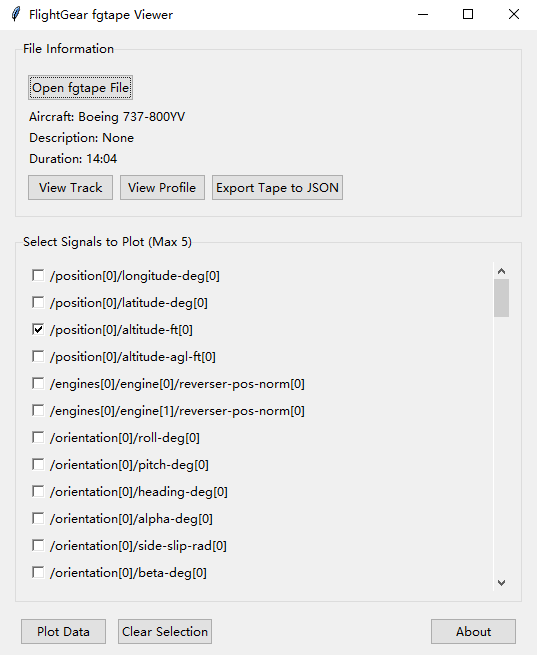

A parser and viewer for the fgtape format. It can visualize the flight path and other data in a tape, and export tapes to JSON. Both normal and continuous tape formats are supported.

### Installation
Windows users can download the PyInstaller-packaged executable directly from the [latest release](https://github.com/container32/fgtape-viewer/releases/latest).  
Or clone the repository:
```bash
git clone https://github.com/container32/fgtape-viewer
cd fgtape-viewer
pip install -r requirements.txt
```

### Usage
#### GUI
After opening an fgtape file, click **Overview** to view the whole flight path. In the list below, check one or two signals and then plot them. Click **Clear Selection** to uncheck them, then check new signals.



#### Command line
Run from the repository root:
```bash
./fgtape_parser.py tape.fgtape -o out.json
./fgtape_viewer.py tape.fgtape
```

### License
This project is licensed under the MIT License.
